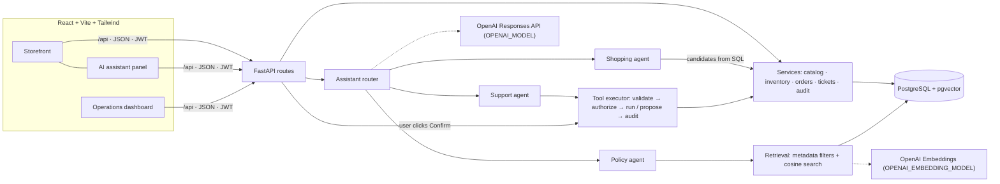

# RetailPulse AI

An omnichannel retail platform for **NovaMart** (HCLTech hackathon): a customer storefront with an AI shopping
assistant, policy answers grounded in approved documents, and a store operations dashboard where every
AI-assisted action is authorized, confirmed by a human and audited.

| Area | What it does |
|---|---|
| Storefront | Catalog with product photos, search, category/brand/price filters, sorting and pagination; product details with stock per store; store selector; cart with server-side pricing; simulated checkout (pickup or delivery) |
| AI recommendations | Natural-language requests become catalog filters; the model ranks only real products fetched from PostgreSQL; prices and availability are attached from the database |
| Policy RAG | Markdown, text, CSV, JSON and PDF policies are chunked and embedded into pgvector; answers cite document title, section and version, or fall back to "can't verify" |
| Support workflow | The assistant looks up the customer's own order and proposes a ticket; nothing is created until the customer presses **Confirm** |
| Operations | KPIs, low-stock alerts, store inventory with per-product stock updates (managers: own store only), CSV import (products, stock levels) with preview and CSV export (catalog, filtered inventory), simulated stock events, ticket queue, order lookup, knowledge base, and an append-only audit log |

## Architecture

A modular monolith: React SPA → FastAPI → PostgreSQL with pgvector. OpenAI is called only from `backend/app/ai/client.py`.



Key flows:

1. **Recommendation:** the model extracts filters (category, budget, brands, urgency) → SQL selects at most 20 real candidates within budget and in stock at the chosen store → the model picks up to 3 by product id with a reason → the server drops any id that wasn't a candidate and adds name, price and availability from the database.
2. **Policy question:** the question is embedded → SQL filters to documents that are active, in effect today, and match the customer's country, membership tier and product (customers never see staff-only procedures) → weak evidence returns the fallback without calling the model → otherwise the model answers with chunk ids → the server rejects citations outside the retrieved set and builds sources from the database.
3. **Support ticket:** the support agent can only call `get_order_status` and `propose_support_ticket`. Identity comes from the JWT, never from tool arguments. A proposal is stored as a pending `action_request`; `POST /api/actions/{id}/confirm` re-checks access and creates the ticket exactly once.
4. **Stock adjustment:** a store manager changes one product's stock from the Inventory page (`POST /api/ops/inventory/adjustments`), or asks the assistant, e.g. *"Increase the stock of product P101 by 20 units"*. Only users with the `inventory:adjust` permission reach the inventory agent, whose single tool `propose_stock_adjustment` takes no store argument: the store comes from the manager's session. Both paths end in one conditional `UPDATE … WHERE quantity + delta >= 0`, so stock can't go negative even under concurrent changes, and every attempt is audited with the old and new quantities.

### How this maps to the brief's recommended stack

The brief recommends Java, Spring Boot 3 and Spring AI; this team implemented the same design in Python.

| Spring AI concept | Here |
|---|---|
| `VectorStore` (PgVector) | `document_chunks.embedding vector(N)` + `backend/app/ai/rag/retrieval.py` |
| `QuestionAnswerAdvisor` | `backend/app/ai/rag/answer.py` (retrieval, evidence gate, citation check) |
| Document readers / splitters | `backend/app/ai/rag/parsers.py`, `chunking.py`, `ingest.py` |
| Function calling | `backend/app/tools/registry.py` (strict schemas) + `executor.py` |
| Structured output converter | Pydantic models with OpenAI structured outputs |

## CSV import and export

On **Operations → Inventory**, the toolbar has **Import CSV** and **Export CSV**. PostgreSQL stays the single source of truth:
imports write through the same models, and exports are generated from the database.

| Endpoint | Who | What |
|---|---|---|
| `POST /api/ops/imports/products/preview` · `POST /api/ops/imports/products` | Admin | Product catalog import. Multipart `file` + `updateExisting` (default `false`) |
| `POST /api/ops/imports/inventory/preview` · `POST /api/ops/imports/inventory` | Store manager (own store), admin | Stock levels per product and store |
| `GET /api/ops/exports/catalog.csv` | Staff | Every active product |
| `GET /api/ops/exports/inventory.csv?storeId=&status=&q=` | Staff (own store), admin (any or all) | The dashboard's current filters |

- **Product CSV columns:** `sku, name, brand, category, price` (required) and `description, image_url, specifications`
  (`key=value;key=value` or a JSON object). The catalog export uses exactly these columns, so an export can be edited and re-imported.
- **Stock CSV columns:** `sku, store_code, quantity` and optional `reorder_level`. The inventory export's extra (read-only) columns are
  accepted and ignored, so it can be edited and re-imported too.
- **Preview first:** every row is validated against the database (missing fields, invalid prices, duplicate SKUs, unknown categories,
  unsafe image URLs, malformed rows) and nothing changes until you confirm. Applying re-validates the file on the server and writes all
  valid rows in one transaction; rows with errors are reported and skipped.
- **No silent overwrites:** existing SKUs are skipped unless *Update existing products* is ticked, and changing existing records needs an
  explicit confirmation. Blank image, description or specification cells never erase current values.
- **Stock is never invented:** a product import creates no stock. Quantities only come from the stock import, which checks every row's
  store against the user's scope and audits each change (old → new).
- **Limits and safety:** `.csv` only, UTF-8, at most 1 MB and 500 rows; unexpected columns reject the file. Exports are UTF-8 (with BOM for
  Excel), and cells starting with `=`, `+`, `-`, `@`, tab or carriage return get a leading `'` so spreadsheets don't run them as formulas.
  Imports, exports and denied attempts are recorded in the audit log.

**Product photos** are category photos from Unsplash stored in `products.image_url` (several products share one). If an image is missing
or fails to load (for example offline), the UI shows the category placeholder instead.

## AI safety and reliability

| Requirement | How it is enforced |
|---|---|
| Prices, ids and stock come from the database | Output schemas have no price or stock fields; recommended ids must be among the SQL candidates; values are joined from the database |
| Grounded answers with sources | Similarity threshold before calling the model; citations must be retrieved chunk ids; sources (title, section, version, effective date) come from the database |
| Say when evidence is missing | Fixed fallback answer with `followUpRequired: true` and LOW confidence |
| Typed, validated, authorized tools | Strict JSON schemas plus server-side Pydantic validation (`extra="forbid"`, order-number pattern); ownership checked as the signed-in user |
| No arbitrary SQL or mutations | Two fixed tools; no query tool; a 4-step cap on the tool loop |
| Confirmation for consequential actions | AI-proposed tickets and stock changes expire in 10 minutes; only the user's Confirm executes them, once, after re-checking permission and store scope |
| Audit successes and failures | `audit_events` records denials, failures, proposals, confirmations, AI answers (with retrieved and cited chunk ids) in a separate transaction; a database trigger makes the table append-only |
| Prompt injection | User text and documents are treated as data in every prompt; authorization never depends on model output |

## Setup

Prerequisites: Python 3.12, Node.js 20.19+ (22 or 24 LTS recommended), PostgreSQL 17 with pgvector.

### 1. Database

```bash
brew install postgresql@17 pgvector
brew services start postgresql@17        # or: pg_ctl -D /opt/homebrew/var/postgresql@17 start
createdb retailpulse && createdb retailpulse_test
```

### 2. Backend (http://localhost:8000, API docs at /docs)

```bash
cd backend
python3 -m venv .venv
.venv/bin/pip install -r requirements.txt
cp .env.example .env                      # set JWT_SECRET; add OpenAI values in step 3
.venv/bin/alembic upgrade head
.venv/bin/python -m scripts.seed_db       # demo catalog (with photos), stores, inventory, users, orders, tickets
# Existing database from before product photos? Add them without touching anything else:
# .venv/bin/python -m scripts.backfill_product_images
.venv/bin/uvicorn app.main:app --reload --port 8000
```

### 3. AI configuration

Set `OPENAI_API_KEY` in `backend/.env`, then list the models your key can use and pick exact IDs (no model is assumed):

```bash
.venv/bin/python -m scripts.check_openai           # prints available chat and embedding models
# set OPENAI_MODEL (e.g. the GPT-5.6 Luna ID if listed) and OPENAI_EMBEDDING_MODEL in .env
.venv/bin/python -m scripts.check_openai --live    # one tiny request to each model, checks EMBEDDING_DIM
.venv/bin/python -m scripts.ingest_knowledge       # embeds the 10 sample policy documents
```

`EMBEDDING_DIM` (default 1536) is fixed in the database schema. `text-embedding-3-*` models are asked for that
size automatically; for another model, set `EMBEDDING_DIM` to its output size before running the migration.
Without an API key the whole app still works; AI features show "not configured".

### 4. Frontend (http://localhost:5173)

```bash
cd frontend
npm install        # .npmrc sets legacy-peer-deps (works around an npm 10.8 peer-resolution crash)
npm run dev        # proxies /api to http://localhost:8000
```

### Tests

```bash
cd backend && .venv/bin/python -m pytest -q
```

The suite runs against `retailpulse_test` with a deterministic fake model (no network, no cost) and covers the
guardrails above: invented product ids, invented citations, missing evidence, tier/country/staff document filters,
cross-customer order access, injected tool arguments, confirm-once, cancel and expiry, overselling, idempotent
checkout, role and store permissions, the append-only audit log, individual stock adjustments (own store only,
never negative, strict integer validation, unknown products, audited old/new quantities, and the AI propose → confirm path), and
CSV import/export (row-level validation, rejected files, explicit updates, admin-only product imports, store-scoped stock imports and
exports, formula-injection guarding, audit records, and export → re-import round trips).

## Demo accounts

Password for every account: `demo123`

| Email | Role | Notes |
|---|---|---|
| aarav@novamart.demo | Customer | Gold, Bengaluru, owns order NM-100042 (a delivered phone) |
| meera@novamart.demo | Customer | Standard, Mumbai |
| omar@novamart.demo | Customer | Platinum, UAE (sees UAE delivery policy) |
| priya@novamart.demo | Store manager | NovaMart Koramangala; can simulate stock events and read the audit log |
| rohan@novamart.demo | Store staff | NovaMart Andheri; ticket queue and order lookup |
| admin@novamart.demo | Admin | All stores |

Reset the demo at any time with `python -m scripts.seed_db` followed by `python -m scripts.ingest_knowledge`.

## Demo script (about 7 minutes)

Before presenting, run `.venv/bin/python -m scripts.warmup` from `backend/`. OpenAI compiles each structured-output
schema on first use, which made the very first requests take over a minute in testing; once warm, a recommendation
takes about 8 seconds and policy or support answers 2–5 seconds.

1. **Shop.** Sign in as Aarav, keep the Koramangala store, filter Laptops, open the Aerion Swift 14 and show stock per store.
2. **Recommend.** Ask the assistant: *"Laptop for Java development under ₹80,000 that I can pick up today."* Show the interpreted requirement, the filter chips and the reasons; prices and availability come from the database. Add one to the cart and check out for pickup: its stock at Koramangala drops into low stock.
3. **Policies.** *"Can I return an opened mobile phone purchased online?"* (cites Online Return Policy › Opened Electronics, v2026.2, not the superseded v2026.1). *"Do Gold members get free express delivery?"* Then something the documents don't cover, e.g. *"Can I pay with cryptocurrency?"*, which returns the clear fallback.
4. **Support.** *"My order NM-100042 arrived with a cracked screen."* The assistant checks the order and proposes a HIGH-priority ticket; press **Confirm** to create it. Ask about NM-100031 (another customer's order): refused.
5. **Operations.** Sign in as Priya: low-stock alerts (including the laptop just sold), simulate a demand spike, the AI-created ticket in the queue (source AI_ASSISTANT), order lookup, and the audit log showing the proposal, confirmation, denied lookup and policy answers with their cited chunks.
6. **Stock updates.** On Inventory, press **Update stock** on a low-stock row (or **Update** next to an alert on Overview) and add 20 units with a reason: the row and the stock-health tiles refresh. Then ask the assistant *"Increase the stock of product P101 by 20 units"*, review the proposed 6 → 26 change and confirm. Trying to remove more units than are in stock, or another store's stock, is refused and logged.
7. **CSV.** As admin, **Export CSV → Product catalog**, then **Import CSV** with a file that has a new product and a few broken rows: the
   preview explains every row before anything changes. As Priya, export Koramangala's inventory, edit a quantity and import it back as
   stock levels.

## Project structure

```
backend/
  app/
    api/routes/      HTTP routes (thin)            core/        config, security, permissions, errors
    services/        business rules                models/      SQLAlchemy models
    ai/              OpenAI client, assistant router, recommendations, rag/ (parse, chunk, ingest, retrieve, answer)
    tools/           tool registry and executor    schemas/     Pydantic request/response models
  alembic/           migrations                    seed/        products.csv, knowledge/ documents + manifest.json
  scripts/           seed_db, ingest_knowledge, check_openai, make_sample_pdf
  tests/
frontend/src/        api/, auth/, layouts/, pages/, components/, features/
```

## Notes

- Payments are simulated (`payment_status = SIMULATED_PAID`); home delivery ships from the central warehouse.
- Stock "API feeds" are simulated from the operations dashboard (demand spike and restock events).
- The hackathon brief is classified Internal; `use case/` is git-ignored because this repository is public.
